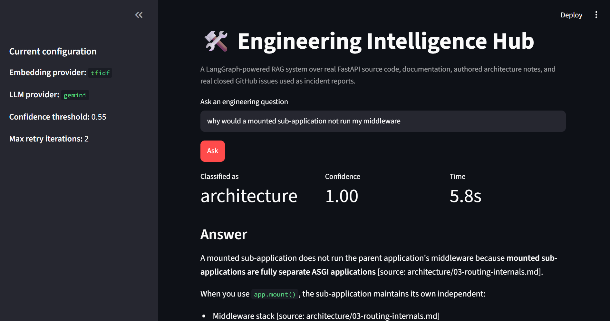
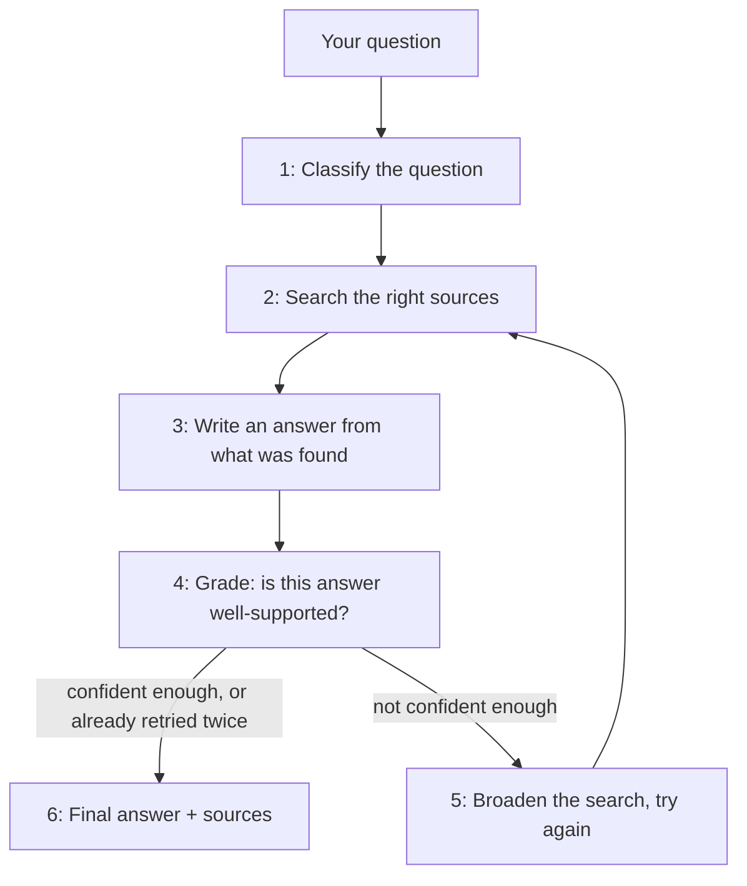
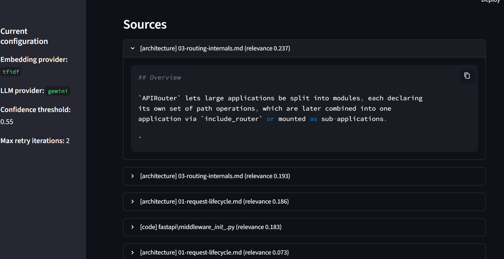

# 🛠️ Engineering Intelligence Hub

A question-answering system for engineering teams. Ask it a question about a
codebase — a bug, a "how do I" question, a design question — and instead of
searching everything every time, it first figures out **what kind of
question it is** and sends it to the right knowledge source automatically.

Built with **LangGraph**, running on real open-source data: the actual
FastAPI source code, its real documentation, real closed GitHub issues used
as incident reports, and a set of architecture notes written for this
project.



## Contents

- [The main idea](#the-main-idea)
- [Tech stack](#tech-stack--what-each-piece-is-for)
- [Where the data comes from](#where-the-data-comes-from)
- [How a question actually gets answered, step by step](#how-a-question-actually-gets-answered-step-by-step)
- [The self-checking loop, tested not assumed](#the-self-checking-loop-tested-not-assumed)
- [Is the free embedding method actually good enough?](#is-the-free-embedding-method-actually-good-enough)
- [What you'll see when you run it](#what-youll-see-when-you-run-it)
- [Try it yourself](#try-it-yourself)
- [Project structure](#project-structure)
- [Switching to a different AI provider](#switching-to-a-different-ai-provider)
- [What I'd add with more time](#what-id-add-with-more-time)

## The main idea

Most "ask a question about my codebase" tools do the same thing every time:
search everything, hand it all to an AI, get an answer. That's simple, but
it's also wasteful and imprecise — a question about a past bug doesn't need
to search API reference docs, and a "how do I" question doesn't need to dig
through incident history. This project instead **reads the question first,
decides what kind of question it is, and only searches the sources that
actually make sense for that kind of question.** That single decision —
routing — is the core idea of this project, and it's what LangGraph is
actually for here: modeling "read the question → decide → search the right
place → answer → double-check → maybe try again" as a real flow with
branches and loops, not just one straight line.

## Tech stack — what each piece is for

| Piece | What it actually does here |
|---|---|
| **Python** | The language everything is written in |
| **LangGraph** | Wires the steps below into one flow that can branch and loop — the orchestration layer |
| **scikit-learn (TF-IDF)** | Turns text into comparable numbers, for free, with no internet needed — the default search method |
| **sentence-transformers** *(optional)* | A smarter, heavier alternative to TF-IDF that understands meaning, not just shared words |
| **Google Gemini** *(or Claude / GPT)* | The actual language model that reads retrieved text and writes the answer |
| **Streamlit** | Turns the whole thing into a web page you can click around in, instead of just a terminal |
| **GitHub's public API** | The real, live source of the incident-report data |

## Where the data comes from

Four kinds of information live in this project, each treated as its own
searchable collection:

| Source | What it is | Where it came from |
|---|---|---|
| **Code** | The real FastAPI library source | Cloned from the real `github.com/fastapi/fastapi` repository |
| **Docs** | FastAPI's real documentation (155 pages) | Same repository |
| **Architecture notes** | 4 diagrams explaining how requests flow through FastAPI | Written for this project, based on reading the real code — clearly marked as such, not official FastAPI docs |
| **Incident reports** | Real bug reports from the FastAPI project | Pulled live from GitHub's public API and reformatted |

## How a question actually gets answered, step by step

This is the part LangGraph is built to model — a flow with a decision point
and a loop, not just one straight line:



1. **Classify the question.** The AI reads the question and labels it as one
   of: `code`, `docs`, `architecture`, `incidents`, or `general` (a fallback
   for anything unclear). This label decides which sources get searched
   next — this is the routing decision.
2. **Search the right sources.** Each source type (code / docs /
   architecture / incidents) is its own searchable collection. The
   question's text is turned into numbers (see "embeddings" below) and
   compared against every stored chunk of text, and the closest matches win.
3. **Write an answer.** The AI is given only the retrieved chunks — not the
   whole codebase — and told to answer strictly from that material, citing
   which file each claim came from.
4. **Grade the answer.** A second AI call asks: "is this answer actually
   backed up by the retrieved material, or is it guessing?" and returns a
   confidence score from 0 to 1.
5. **If not confident enough, try again — but smarter.** The search query
   gets rewritten and widened to *all four* source types (not just the ones
   the first guess picked), in case the initial classification was wrong or
   too narrow. This can happen at most twice, so it can never loop forever.
6. **Finalize.** The answer, its confidence score, and every source it drew
   from are assembled into one response.

### How the text gets ready to be searched (chunking)

Before any of the above can happen, every file in `data/raw/` gets split
into smaller pieces ("chunks") that get compared against a question:

- **Code files** are split into overlapping windows of about 80 lines each,
  so a function that spans a chunk boundary is still findable from either
  side.
- **Markdown files** (docs, architecture notes, incident reports) are split
  at their own headers first, so a chunk stays within one logical section,
  then further split by length if a section runs long.

Each chunk keeps track of exactly which file and which lines it came from —
that's what makes the citations in the final answer possible.

## The self-checking loop, tested not assumed

It's easy to add a "confidence check + retry" step and just assume it
helps. I didn't want to assume — so I ran the same 16 questions through the
system twice: once with the retry loop turned off, once with it on, and
compared the confidence scores.

| | Retry off | Retry on |
|---|---|---|
| Average confidence | 0.519 | 0.523 |
| Worst-case confidence | 0.150 | 0.270 |
| Questions below the "trustworthy" line | 9 / 16 | 8 / 16 |

The honest result: **5 questions got better, 4 got slightly worse, 7 stayed
the same.** Not a clean win — and that's a more truthful finding than
pretending it always helps. Where it clearly earns its place: the *worst*
question in the test ("how does a request flow through FastAPI, start to
finish" — a vague question with no obvious search target) jumped from a
confidence of 0.15 to 0.27 once the loop kicked in and widened the search.
So the loop's real job isn't to make every answer a little better — it's to
**catch the questions that would otherwise fail badly**, at the cost of a
few extra seconds on borderline cases. You can reproduce this yourself:

```bash
python scripts/eval_retry_loop.py
```

## Is the free embedding method actually good enough?

The default search method (TF-IDF) is a simple, free way to compare text
based on shared words. A smarter, heavier alternative
(`sentence-transformers`, via HuggingFace) actually understands meaning
rather than just matching words — but it needs to download a model, so it's
not the default. Before deciding TF-IDF was good enough, I tested it
against 10 hand-checked (question → correct source file) pairs:

**TF-IDF result:** every one of the 10 questions found its correct source
in the top 5 results, and 8 of 10 found it at rank 1 (`Hit@5 = 1.00`,
`MRR@5 = 0.842`). That's a strong result, and not a fluke: FastAPI's own
code and docs use consistent, specific words (`response_model`,
`include_router`, `Depends`), and questions asked with similarly specific
words have a lot of word-overlap with their answers. TF-IDF is fundamentally
a word-matching method, so it does well exactly in that situation — it
would likely do worse on a paraphrased, conversational question that
doesn't share the doc's exact wording.

```bash
pip install sentence-transformers   # needs real internet access, downloads a model
python scripts/eval_embeddings.py
```

Run the command above yourself (with normal internet access) to see how the
smarter method compares — I couldn't finish that half of the test in the
sandbox this project was built in, since it couldn't reach the model
download server.

## What you'll see when you run it

The web page (`app.py`) doesn't just show an answer — it shows *why* you
got that answer, so the routing and confidence-checking described above
aren't hidden behind a normal-looking chat box:

- **A "🔍 How I got this answer" panel** under every response, showing
  which category the question was classified into, which sources got
  searched, and — if it happened — that the system wasn't confident on the
  first try and broadened the search before answering.
- **Clickable sources.** Every citation links straight to the real file on
  GitHub (or the real GitHub issue, for incident reports) — so you're never
  just trusting the answer, you can always check the original.



The screenshots above are this project running live, answering *"why would
a mounted sub-application not run my middleware?"* — a real FastAPI design
question, correctly classified as an **architecture** question and answered
with a specific, sourced fact rather than a generic guess.

## Try it yourself

1. **Get a free Gemini API key** (no credit card): go to
   [aistudio.google.com/apikey](https://aistudio.google.com/apikey), sign
   in with a Google account, click "Create API key."

2. **Set up the project:**
   ```bash
   git clone <this-repo-url>
   cd engineering-intelligence-hub
   python -m venv .venv
   source .venv/bin/activate        # Windows Git Bash: source .venv/Scripts/activate
   pip install -r requirements.txt
   pip install google-genai streamlit
   ```

3. **Add your key:**
   ```bash
   cp .env.example .env
   ```
   Open `.env` and set:
   ```
   LLM_PROVIDER=gemini
   GEMINI_API_KEY=paste-your-key-here
   ```

4. **Build the search index** (one-time step):
   ```bash
   python scripts/ingest.py
   ```

5. **Launch it:**
   ```bash
   streamlit run app.py
   ```
   Opens automatically at `http://localhost:8501`. Ask it a question.

No key handy? It also runs **completely free with zero setup** — just skip
step 3, and it uses a simple offline mode instead of Gemini (see below).

## Project structure

```
engineering-intelligence-hub/
├── config.py                    # every setting, all controlled by .env
├── data/raw/                    # code / docs / architecture / incidents
├── src/
│   ├── ingestion/                # reads raw files, splits them into chunks
│   ├── retrieval/                # turns chunks into searchable numbers
│   ├── llm/                      # swappable AI backend (mock/gemini/anthropic/openai)
│   └── graph/                    # the LangGraph flow: classify → search → answer → grade → retry
├── scripts/
│   ├── ingest.py                 # builds the search index
│   ├── ask.py                    # ask a question from the terminal
│   ├── fetch_incidents.py        # pulls more real bug reports from GitHub
│   ├── eval_retry_loop.py        # proves whether the retry loop helps
│   └── eval_embeddings.py        # compares TF-IDF vs smarter embeddings
├── app.py                        # the web page (Streamlit), with the "how I got this answer" panel
└── tests/                        # automated checks, run fully offline
```

## Switching to a different AI provider

Everything above uses Gemini's free tier, but Claude and GPT work too — just
change two lines in `.env`:

```bash
LLM_PROVIDER=anthropic
ANTHROPIC_API_KEY=sk-ant-...
```
or
```bash
LLM_PROVIDER=openai
OPENAI_API_KEY=sk-...
```

## What I'd add with more time

- A bigger incident-report corpus (only 7 real bug reports are bundled, to
  stay under GitHub's public rate limit — `fetch_incidents.py` can pull far
  more with a free GitHub token).
- A head-to-head test between TF-IDF and real dense embeddings on
  *paraphrased* questions specifically — the kind that don't share exact
  wording with the docs, which is where TF-IDF's keyword-matching approach
  should start to lose to a method that understands meaning.
- Swapping the offline "mock" query-rewriter for a real one, since the
  retry-loop evaluation above suggests the current rewrite strategy is the
  weak link, not the loop itself.
