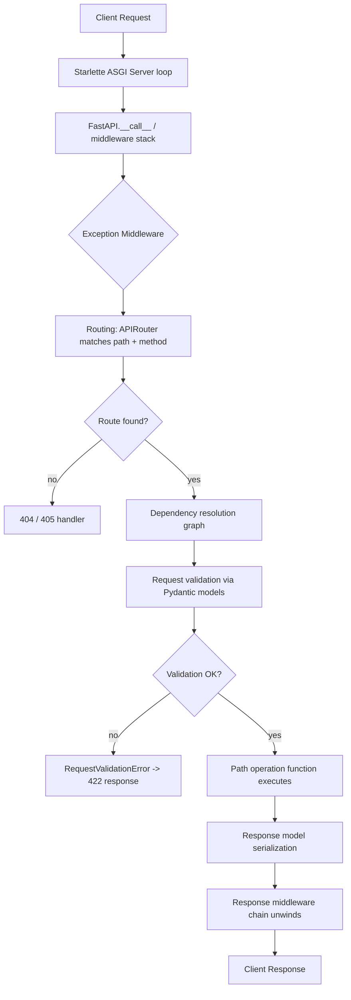

# Architecture Note: Request Lifecycle

> **Note on provenance:** This document is *authored for this project* as a
> stand-in for the kind of internal architecture notes a real engineering org
> would maintain. It describes, at a high level, how the actual open-source
> FastAPI codebase (ingested in `data/raw/code/fastapi`) handles an incoming
> HTTP request, based on reading `applications.py` and `routing.py`. It is not
> an official FastAPI document.

## Overview

Every incoming HTTP request to a FastAPI application passes through a layered
pipeline before a handler function ever runs, and again on the way out before
a response is sent to the client.

## Key stages

1. **ASGI entry point.** FastAPI is a thin layer over Starlette's ASGI
   application. The `FastAPI` class (`applications.py`) builds the middleware
   stack once at startup, wrapping the router with exception-handling
   middleware.
2. **Routing.** `routing.py` defines `APIRoute` and `APIRouter`, which match
   the incoming path and method against registered path operations,
   including support for path parameters, mounted sub-applications, and
   `include_router` composition.
3. **Dependency resolution.** Before the handler runs, FastAPI walks the
   dependency graph declared via `Depends(...)`, resolving each dependency
   (which may itself have sub-dependencies), respecting caching within a
   single request.
4. **Validation.** Request bodies, query parameters, and path parameters are
   validated and coerced using Pydantic models. Failures raise
   `RequestValidationError`, which the exception middleware converts into a
   422 response with structured error detail.
5. **Response handling.** The return value of the path operation function is
   serialized against the declared `response_model` (if any), then passed
   back up through the middleware stack (CORS, GZip, custom middleware, etc.)
   before being sent to the client.

## Common failure points (cross-reference with incident reports)

- Middleware ordering bugs (headers/background tasks lost when combined with
  streaming responses — see incident reports tagged `streaming`).
- Sub-application mounting edge cases affecting route resolution (see
  incident reports tagged `routing`).
- Type-checker/typing regressions in route decorators that don't affect
  runtime behavior but break developer tooling (see incident reports tagged
  `typing`).
