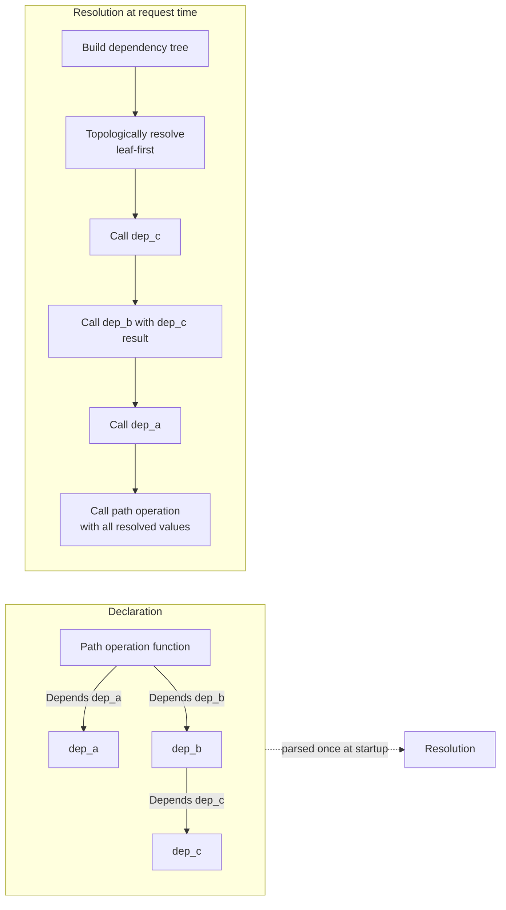

# Architecture Note: Dependency Injection System

> **Note on provenance:** Authored for this project as an internal-style
> architecture note, based on reading `dependencies/utils.py` and
> `params.py` in the ingested FastAPI source. Not an official FastAPI
> document.

## Overview

FastAPI's dependency injection (DI) system is one of its defining features.
Dependencies are plain callables (functions, or callable classes) declared
via `Depends(...)` as default parameter values on a path operation function.

## Key mechanics

1. **Static analysis at route registration.** When a route is registered,
   FastAPI inspects the function signature and recursively builds a
   dependency tree (`get_dependant` in `dependencies/utils.py`), capturing
   which parameters come from the path, query, headers, cookies, body, or
   from other dependencies.
2. **Per-request caching.** By default, a dependency used multiple times in
   one dependency tree (e.g., an auth dependency needed by two other
   dependencies) is only *called once per request* and the result is
   reused, controlled via `use_cache` on `Depends`.
3. **Sub-dependencies and `yield`.** Dependencies may themselves declare
   dependencies, forming an arbitrarily deep graph. Dependencies that use
   `yield` instead of `return` support setup/teardown (e.g., DB session
   open/close), with the code after `yield` running after the response has
   been sent (or after an exception, wrapped in `contextlib`-style
   exit-stack handling).
4. **Security dependencies.** OAuth2/API-key schemes are implemented as
   regular dependencies with extra OpenAPI metadata attached, which is why
   they compose with the same caching/sub-dependency rules as any other
   dependency.

## Why this matters for onboarding

New engineers frequently misunderstand two things about this system:

- Dependencies with `yield` are **not** context managers you call yourself —
  the framework manages the enter/exit around the request lifecycle.
- Dependency *caching is per-request*, not global — a dependency will run
  again on the next request even with `use_cache=True`.

Misunderstanding either of these is a common source of "why did my DB
session close early" or "why did my auth check run twice" questions —
exactly the kind of question this RAG system is meant to answer quickly by
pulling both this architecture note and the relevant source lines from
`dependencies/utils.py`.
