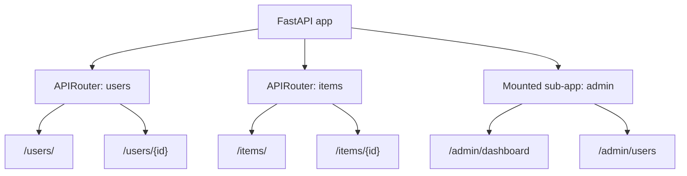

# Architecture Note: Routing & APIRouter Composition

> **Note on provenance:** Authored for this project based on reading
> `routing.py` in the ingested FastAPI source. Not an official FastAPI
> document.

## Overview

`APIRouter` lets large applications be split into modules, each declaring
its own set of path operations, which are later combined into one
application via `include_router` or mounted as sub-applications.

## Key mechanics

1. **Route matching order.** Routes are matched in registration order;
   the first matching path + method wins. This matters when routes overlap
   (e.g., a static `/users/me` route must be registered *before* the dynamic
   `/users/{id}` route, or `{id}` will greedily match `"me"`).
2. **`include_router` merges, doesn't isolate.** When a router is included
   with a `prefix` and `tags`, its routes become first-class routes on the
   parent app — they share the same exception handling and middleware stack
   unless a fully separate sub-application (via `app.mount`) is used instead.
3. **Mounted sub-applications are fully separate ASGI apps.** `app.mount()`
   delegates an entire path prefix to another ASGI application (which may
   itself be a FastAPI app), which has its own independent middleware,
   exception handlers, and OpenAPI schema. This is a common source of
   confusion when developers expect a mounted app to inherit the parent's
   middleware.
4. **Path parameter edge cases.** Path segments containing dots, trailing
   slashes, or empty segments interact with route-matching regexes in ways
   that are easy to get wrong when writing catch-all/fallback routes (see
   the incident report on `app.frontend()` fallback routing).

## Why this matters for troubleshooting

Most "my route isn't matching" or "my middleware isn't running for this
endpoint" incidents trace back to one of the three mechanics above: route
ordering, include_router vs. mount, or path-parameter regex edge cases.
