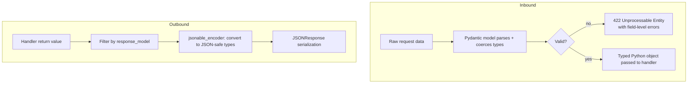

# Architecture Note: Validation & Serialization Pipeline

> **Note on provenance:** Authored for this project based on reading
> `encoders.py` and the Pydantic-integration parts of `routing.py` in the
> ingested FastAPI source. Not an official FastAPI document.

## Overview

FastAPI leans on Pydantic for both **input validation** (request bodies,
query/path params) and **output serialization** (response models).

## Key mechanics

1. **Declarative validation.** Type hints on path operation parameters
   (`item: Item`, `q: str | None = None`) are turned into a Pydantic model
   at route-registration time; validation errors are collected per-field.
2. **`response_model` is a filter, not just documentation.** Even if a
   handler returns extra fields, only fields declared on `response_model`
   are serialized in the response — this is a common surprise for engineers
   used to frameworks where the return value is serialized as-is.
3. **`jsonable_encoder`.** Before final JSON serialization, FastAPI
   recursively converts non-JSON-native types (datetimes, UUIDs, Enums,
   Pydantic models, dataclasses) into JSON-compatible primitives.
4. **Errors are structured, not just strings.** `RequestValidationError`
   carries a list of per-field error objects (`loc`, `msg`, `type`), which
   is what the auto-generated 422 responses expose to API consumers.

## Why this matters

Two of the most common "confusing bug" categories map directly onto this
diagram:

- Fields silently missing from a response → check `response_model`
  filtering, not the handler logic.
- Unexpected 422s on inputs that "look correct" → check type coercion
  rules (e.g., FastAPI/Pydantic will coerce `"123"` to `int` for query
  params, but stricter models may reject the same string for a body field).
